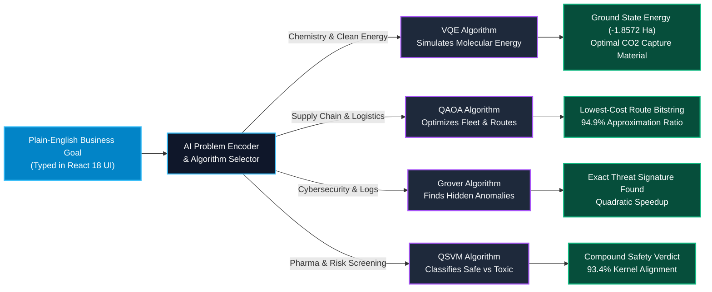
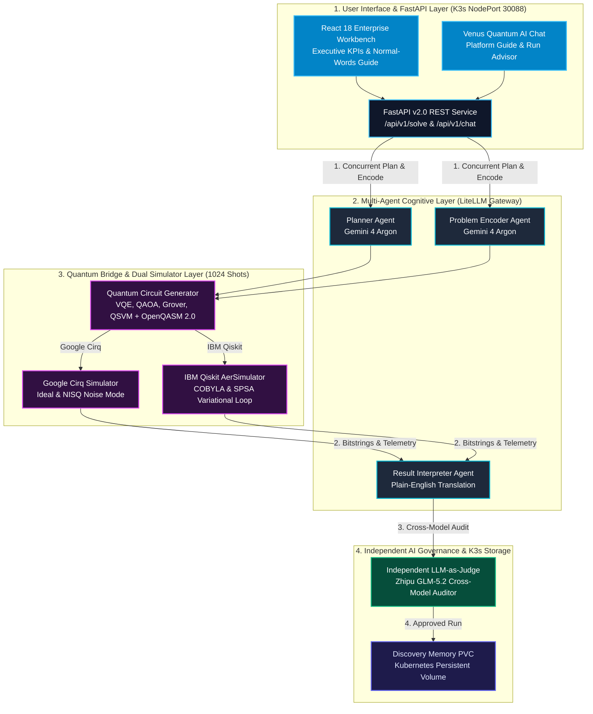
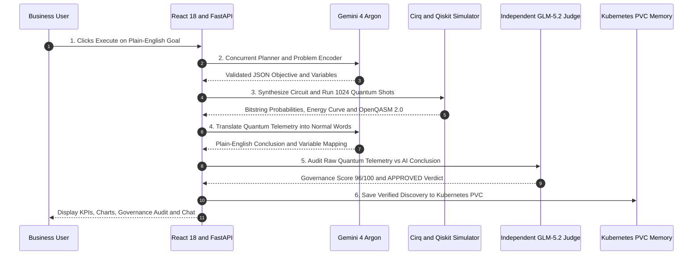

# ⚛️ Venus: Governed Quantum Agents (GQA) — Enterprise Platform v2.0

**A Governed, Natural-Language Quantum Discovery Platform with React 18 Executive Workbench, Dual-SDK Quantum Execution (Google Cirq & IBM Qiskit), LiteLLM Multi-Agent Routing, and Kubernetes / K3s Helm Deployment.**

[](https://python.org)
[]()
[](https://quantumai.google/cirq)
[-6929C4?style=flat-square&logo=ibm&logoColor=white)](https://qiskit.org)
[](helm/governed-quantum-agents)
[-4A90E2?style=flat-square)](#)
[](LICENSE)
[-0A66C2?style=flat-square&logo=linkedin)](https://www.linkedin.com/in/marian-rop)
[](https://www.credly.com/users/marian-ropota/badges/credly)

> *"Describe your optimization, molecular chemistry, cybersecurity, or risk-classification objective in plain English. Let Governed AI Agents formulate the Hamiltonian, synthesize & execute the quantum circuit, and audit every conclusion for regulatory & scientific compliance."*

---

## 🎯 Executive Value Proposition — For Managers, HR & Quantum/AI Architects

### 👔 For Engineering Managers, CTOs & Enterprise Decision Makers
- **Bridging the Quantum Talent & Adoption Gap:** Enterprise R&D teams in logistics, clean energy, pharmaceuticals, and cybersecurity can run hybrid quantum-classical workflows (**VQE, QAOA, Grover, QSVM**) through a **business-friendly React 18 Workbench** without writing low-level quantum gate code.
- **Built-In AI Governance & Regulatory Auditability (`LLM-as-Judge`):** Every quantum simulation output and natural-language interpretation is audited by an independent LLM Judge against **scientific realism, statistical shot significance, and GDPR/HIPAA compliance** before being persisted to Kubernetes PVC storage.
- **Cloud-Native & Vendor-Agnostic:** Switch seamlessly between **Google Cirq** and **IBM Qiskit** on the quantum layer, and between **Google Vertex AI (Gemini 3.8 Flash, Gemini 3.1 Pro, Zhipu GLM-5.2 1M MaaS)**, **Mistral Codestral**, and **NVIDIA NIM** via the centralized **LiteLLM Gateway (`:4001`)**.

### 🤝 For HR, Talent Acquisition & Hiring Managers (Competency Matrix)
This repository demonstrates end-to-end ownership across **Quantum Computing, Multi-Agent AI Governance, Full-Stack React/FastAPI Engineering, and Kubernetes/Helm Cloud-Native Operations**:

| Core Enterprise Domain | Concrete Engineering Proof in This Repository | Aligned Senior / Principal Roles |
|---|---|---|
| **Quantum Computing & Hybrid Algorithms** | Dual-SDK circuit synthesis (**Google Cirq** & **IBM Qiskit**) for **UCCSD-inspired VQE** (Hartree-Fock $\to$ Ground State energy convergence in Ha), **$p=2$ QAOA Ising QUBO**, **Optimal-$k_{\text{opt}}$ Grover Phase Oracles**, and **2nd-Order Pauli `ZZFeatureMap` QSVM Kernels**, complete with **OpenQASM 2.0 export** & **NISQ Depolarizing Noise simulation**. | *Quantum Software Architect • Hybrid Quantum-AI Engineer* |
| **Multi-Agent AI & LLM-as-Judge Governance** | Asynchronous Python `asyncio` + **Pydantic v2** schema-enforced agent pipeline (*Planner → Problem Encoder → Circuit Generator → Quantum Executor → Interpreter → Governance Judge*) routed via **LiteLLM Gateway (`litellm-agents`)** with cross-model auditing. | *Principal AI/GenAI Architect • AI Governance & Safety Lead* |
| **Full-Stack Enterprise Web UI & API** | Built-in **React 18 Enterprise Workbench (`src/static/index.html`)** with 1-click industry scenarios, animated 6-stage pipeline tracker, SVG variational convergence & bitstring histograms, and **FastAPI REST API (`src/api.py`)**. | *Lead AI Product Engineer • Staff Full-Stack AI Engineer* |
| **Kubernetes (K3s), Helm & DevSecOps** | Production **Helm Chart (`helm/governed-quantum-agents/`)** deploying into a dedicated `quantum` namespace with dynamic `local-path` **PVC/PV storage**, Kubernetes `Secret` injection, `.env` security isolation, and automated `pytest` verification. | *Staff Platform / MLOps / Kubernetes Architect* |


---

## Table of Contents
- [🎯 TL;DR: The Ultimate Goal](#-tldr-the-ultimate-goal)
- [What Are Governed Quantum Agents?](#what-are-governed-quantum-agents)
- [The Core Thesis](#the-core-thesis)
- [Architecture](#architecture)
  - [Bloat-Free Software Stack](#bloat-free-software-stack)
- [How It Works](#how-it-works)
- [🚀 Quick Start](#-quick-start)
- [Enterprise Readiness & ROI](#enterprise-readiness--roi)
- [Use Cases](#use-cases)
- [Hybrid Infrastructure & LLM Routing](#hybrid-infrastructure--llm-routing)
- [Tech Stack](#tech-stack)
- [Project Status & Roadmap](#project-status--roadmap)
- [🌐 FastAPI & Docker Deployment](#-fastapi--docker-deployment)
- [📸 Live Execution Proofs & Gallery](#-live-execution-proofs--gallery)
  - [📝 Live Execution Logs & API Examples](#-live-execution-logs--api-examples)
  - [🖼️ Screenshot Gallery](#-screenshot-gallery)
- [💻 Simulators vs. Real Quantum Hardware](#-simulators-vs-real-quantum-hardware)
- [Why Now?](#why-now)
- [Relationship to AI Governance Lab](#relationship-to-ai-governance-lab)
- [🧪 Interactive Examples (Jupyter Notebooks)](#-interactive-examples-jupyter-notebooks)

---

## 🎯 TL;DR: The Ultimate Goal

The ultimate goal of Venus is to act as a **translation layer** between human intent and complex quantum computers. 

Instead of needing a PhD in quantum linear algebra to write circuit code, a scientist can simply type:
> *"Find a candidate molecule that inhibits this specific enzyme without being toxic."*

Here is exactly what the AI Agents do behind the scenes:
1. **Understand:** The primary LLM parses the plain-English request.
2. **Translate to Math:** The agents figure out which quantum algorithm is needed and write the Python/Cirq code to generate the actual quantum circuit.
3. **Execute:** The circuit is executed (currently on simulators, eventually on real hardware).
4. **Interpret:** Quantum computers return raw probability distributions (1s and 0s). The LLM reads these statistics and translates them back into a human answer.
5. **Govern:** A separate LLM "Governance Judge" watches the entire process to ensure the AI didn't hallucinate, didn't break compliance (like GDPR/HIPAA), and that the science makes sense.

**In short: An AI Agent that safely writes and executes quantum programs on your behalf.**

---

## What Are Governed Quantum Agents?

Quantum computers are not just faster classical computers; they are fundamentally different. They explore vast combinatorial spaces simultaneously—solution landscapes so large that no classical system could traverse them in a human lifetime. However, harnessing that power usually requires deep expertise in quantum circuit design, linear algebra, and algorithmic mapping. The interface to quantum computing has historically been a PhD.

**Venus: Governed Quantum Agents (GQA)** removes that barrier.

rVenus (GQA) is an enterprise-grade agentic AI system that translates a natural language discovery goal into a quantum computation, executes it, and returns human-readable results—all under a strict **AI Governance framework**. You describe what you want to find—a candidate drug molecule, an optimal material structure, a novel synthesis pathway, an engineering solution—and the agents orchestrate everything securely.

```text
"Find me candidate molecules that inhibit the BACE-1 enzyme
 with minimal off-target effects."
                    ↓
        [ Governed Quantum Agent ]
                    ↓
"Here are 7 high-potential candidates ranked by binding affinity
 score, validated for toxicity, with structural rationale for each."
```

---

## The Core Thesis

The human-quantum interface is the primary barrier to enterprise adoption.

Quantum hardware is advancing rapidly, and algorithms for drug discovery, financial optimization, and materials science are proven. What is missing is the translation layer—a system that takes a human goal and turns it into a quantum computation without requiring the user to understand what a qubit or parameterized circuit is.

Furthermore, for this translation layer to be adopted by enterprises, it cannot be a "black box" LLM. It must be **governed, observable, and verifiable**. Venus is built to be that secure translation layer, positioned today for an inflection point that is already visible.

---

## 🏗️ System Architecture & Workflow Diagrams

Venus is architected as a **five-layer sovereign enterprise platform** combining a **React 18 Executive Workbench**, **FastAPI Microservice**, **Multi-Agent LiteLLM Orchestration**, **Dual-SDK Quantum Execution (Google Cirq & IBM Qiskit)**, and an **Independent LLM-as-Judge Governance Observatory** deployed on **Kubernetes (K3s) via Helm**.

### 1. How Plain-English Business Goals Map to Quantum Algorithms (Executive Overview)



---

### 2. End-to-End Enterprise Quantum & AI Governance Architecture



---

### 3. Step-by-Step Governed Discovery & Cross-Model Audit Sequence


---

## How It Works

### Step 1 — Intent Parsing
The language interface (powered by Gemini 2.5 Pro or local models) understands what the user wants to discover. It extracts the domain (chemistry, logistics, etc.), the objective function (minimize, maximize, find candidates), and constraints safely.

### Step 2 — Problem Decomposition
The Planner Agent breaks the goal into subproblems mapped to quantum algorithms:

| Problem Type | Quantum Algorithm | Example |
|---|---|---|
| Combinatorial optimization | **QAOA** | Drug-protein binding optimization |
| Molecular simulation | **VQE** | Ground state energy of candidate molecule |
| Search in unstructured space | **Grover's** | Pattern search in compound libraries |
| Classification | **QSVM** | Toxicity prediction |

### Step 3 — Quantum Circuit Execution
Circuits are dynamically built and executed. With our **Backend-Agnostic architecture**, Venus supports generating both **Google Cirq** and **IBM Qiskit** circuits on the fly, allowing for execution on local simulators (`cirq.Simulator`, `qiskit_aer.AerSimulator`) or seamless cloud execution on real quantum hardware like IBM Quantum or Google Sycamore.

### Step 4 — Result Interpretation & Memory
Raw quantum output (probability distributions over bitstrings) is meaningless without context. The Interpreter Agent translates these back into domain language. Every run is stored in a vector database, allowing the agents to build a map of the discovery space across sessions—refining hypotheses and avoiding dead ends.

### Step 5 — LLM-as-Judge Governance (The Verifier)
Before any result is presented to the user, an independent `Judge Agent` evaluates the output against safety, compliance, and scientific validity guidelines. Hallucinations or insecure interpretations are caught here.

---

## 🚀 Quick Start

### Prerequisites
- Python 3.11+
- Credentials for your preferred LLM provider (e.g., `GEMINI_API_KEY`, `OPENAI_API_KEY`, or local `vLLM`/`Ollama` running)

### Installation
1. Clone the repository:
   ```bash
   git clone https://github.com/AI-Governance-Lab/governed-quantum-agents.git
   cd governed-quantum-agents
   ```

2. Create a virtual environment and install dependencies:
   ```bash
   python -m venv venv
   source venv/bin/activate
   pip install -r requirements.txt
   ```

3. Configure your environment variables:
   ```bash
   cp .env.example .env
   # Edit .env to add your API keys
   ```

### Running a Discovery Goal
To execute a discovery goal, pass the natural language goal as a positional argument. By default, Venus uses the Google Cirq backend.
```bash
python src/main.py "Find an optimal alloy with tensile strength above 900 MPa"
```

To leverage the **IBM Qiskit** backend for circuit generation and execution, simply pass the `--framework qiskit` flag:
```bash
python src/main.py "Find an optimal alloy with tensile strength above 900 MPa" --framework qiskit
```

To run the agents using a different primary LLM (e.g. OpenAI GPT-4o, Anthropic Claude 3.5), use the `--model` flag:
```bash
python src/main.py "Find candidate molecules that inhibit COX-2" --model openai/gpt-4o
```

### Running Tests
To run the automated agentic and quantum simulation tests:
```bash
pytest
```

---

## Community & Academic Impact

Venus is designed to democratize quantum computing, breaking down the mathematical barriers for students, researchers, and open-source developers.

### 2. Research Budget Management
Running hybrid quantum-classical workloads can be expensive for university departments. By routing all agentic LLM calls through **LiteLLM**, Venus provides built-in budget controls:
* **Cost-per-Discovery Tracking**: Quantify the exact API and compute cost for every successful simulation.
* **Grant Budget Caps**: Prevent overruns by setting hard limits on token usage and cloud API spend per research project.

### 3. Reproducible Science & Open Data
For the academic community, transparency is critical. The internal **LLM-as-Judge** evaluator acts as a peer-reviewer, generating an **immutable audit log** for every decision. This provides end-to-end traceability of how a molecule was selected or why a quantum circuit was designed in a specific way, ensuring experiments are fully reproducible.

### 4. Open-Source Collaboration
Venus is built for collaborative science:
* **Domain Scientists**: Can run quantum simulations using only natural language, without needing to learn Qiskit or Cirq APIs.
* **Quantum Physicists**: Can easily plug in new algorithm architectures into the `Classical-Quantum Bridge`.
* **AI Researchers**: Can swap the intelligence models instantly using the `--model` flag to experiment with new open-source models like Meta Llama or Mistral.

---

## Use Cases

**🌍 Climate Tech & Carbon Capture**
> *"Discover novel Metal-Organic Frameworks (MOFs) that maximize CO2 absorption at room temperature."*
> **Execution:** VQE (Variational Quantum Eigensolver) simulates the molecular ground states. The Governance Judge verifies the scientific validity against known thermodynamics before presenting the candidate.

**💊 Pharmaceutical Discovery**
> *"Find candidate molecules that could inhibit COX-2 with minimal off-target effects."*
> **Execution:** Maps to a VQE circuit, simulates ground state energies, and returns ranked compounds, accelerating the early stages of drug discovery.

**🔬 Materials Science**
> *"Find a lightweight alloy composition with tensile strength above 900 MPa and high corrosion resistance."*
> **Execution:** Encodes multi-objective optimization as a QAOA problem, allowing researchers to search compositional spaces exponentially faster than classical brute-force methods.

**🛡️ Cryptography & Computational Search**
> *"Search large unstructured datasets to find the exact signature of a specific network anomaly."*
> **Execution:** Utilizes Grover's Algorithm to execute unstructured searches exponentially faster, highlighting quantum advantages in data processing limits.

---

## 100% LLM-Agnostic & Hybrid Infrastructure

Venus is **completely model-agnostic** by design. All LLM calls are routed through **LiteLLM**—a unified proxy that normalizes 100+ providers into a single API. You can switch the intelligence engine driving the quantum agents at any time using the `--model` command-line flag.

This allows Venus to operate in two distinct modes depending on enterprise requirements:

### Mode 1: Enterprise Cloud 
By default, Venus uses Google Gemini 2.5 Pro, but you can seamlessly swap to any major provider.

| Agent Role | Primary Configurable LLM (Examples) | Fallback / Heavy Strategy (Examples) |
|---|---|---|
| **Language Interface** | `vertex_ai/gemini-2.5-pro` (default)<br>`openai/gpt-4o`<br>`anthropic/claude-3-7-sonnet` | `openai/gpt-4o-mini` / `anthropic/claude-3-7-sonnet` |
| **Planner Agent** | *Configurable via `--model`* | `mistral/mistral-large-latest` / `openai/gpt-4o` |
| **Interpreter Agent**| *Configurable via `--model`* | `gemini/1.5-flash` / `anthropic/claude-3-5-sonnet` |
| **Governance Judge** | *Configurable via `--model`* | `groq/llama-3.3-70b` (Meta) / `openai/o1-preview` |

### Mode 2: Private Local (Strict Data Residency)
For organizations with absolute data residency concerns, Venus can run on **local private infrastructure** (e.g., NVIDIA DGX, Dell servers) using local open-source LLMs. In this mode, discovery targets never leave the internal network.

#### High-Throughput (NVIDIA A100/H100 + vLLM)
For enterprise-scale discovery and massive concurrent agent operations, Venus routes to **vLLM** for OpenAI-compatible, high-throughput model serving.
| Command | Size | Best for |
|---|---|---|
| `--model vllm/meta-llama/Llama-3.3-70B-Instruct` | 70B | Primary planning & governance |
| `--model vllm/Qwen/Qwen2.5-Coder-32B-Instruct` | 32B | Complex planning & tool use |

#### Lightweight (CPU/Entry-GPU + Ollama)
For edge environments or lighter workloads.
| Command | Size | Best for |
|---|---|---|
| `--model ollama/llama3.3` | 70B | Primary planning & governance |
| `--model ollama/llama3.2` | 3B / 1B | Fast intent parsing |
| `--model ollama/gemma2` | 27B | Reasoning, result interpretation |
| `--model ollama/deepseek-r1` | 14B | Complex planning |

LiteLLM handles retries, fallbacks, cost tracking, and provider normalization transparently across all modes and backends.

---

## Tech Stack

| Component | Technology |
|---|---|
| **Primary Reasoning Engine** | Google Gemini Pro (Default) / OpenAI / Anthropic / Mistral / Meta Llama |
| **LLM Gateway & Routing** | LiteLLM |
| **Quantum Execution** | Google Cirq / IBM Qiskit (Aer Simulator) |
| **Quantum Algorithms** | QAOA, VQE, Grover's, QSVM |
| **Agent Framework** | Python 3.11, asyncio |
| **Discovery Memory** | FAISS / ChromaDB (Vector Store) |
| **Data Validation** | Pydantic v2 |
| **Infrastructure** | GCP / NVIDIA DGX (A100/H100) / Local Dell Server |

---

## Project Status & Roadmap

| Phase | Milestone | Status |
|---|---|---|
| **v0.1** | Cirq simulation core & Cloud LLM routing (LiteLLM) | ✅ Complete |
| **v0.2** | Vertex AI Gemini 2.5 Pro integration for Agentic loop | ✅ Complete |
| **v0.3** | Governance Evaluator (LLM-as-Judge pipeline) | ✅ Complete |
| **v0.4** | VQE for molecular simulation in chemistry domain | ✅ Complete |
| **v0.5** | Multi-session discovery memory | ✅ Complete |
| **v0.6** | Pydantic strict JSON validation & Asyncio Execution Loop | ✅ Complete |
| **v0.7** | Dynamic Quantum Circuits scaling with Problem Variables | ✅ Complete |
| **v0.8** | **Qiskit Integration** (Multi-backend execution: IBM & Google) | ✅ Complete |
| **v1.1** | **FastAPI Backend (REST API)** | ✅ Complete |
| **v2.0** | **React 18 Enterprise Workbench UI, Variational Telemetry, OpenQASM 2.0, NISQ Noise & K3s Helm Chart** | ✅ Complete |
| **v2.1** | **Real Quantum Hardware Backend Execution** (IBM Quantum Cloud QPU) | 🎯 **Grant Target** |

---

## 🖥️ React 18 Enterprise Workbench & Kubernetes (K3s) Helm Deployment

Venus v2.0 ships with an integrated **React 18 Enterprise Workbench UI** served directly at `/` alongside the FastAPI OpenAPI documentation (`/docs`), plus a production **Kubernetes / K3s Helm Chart** (`helm/governed-quantum-agents/`).

### 1. Deploying on Kubernetes / K3s via Helm (`quantum` Namespace)

The repository includes a complete Helm chart (`helm/governed-quantum-agents`) featuring:
- **Dedicated Namespace:** `quantum`
- **Dynamic Persistent Volume (`PVC` / `PV`):** Uses the `local-path` StorageClass (`2Gi`, `ReadWriteOnce`) mounted at `/app/data/discovery_memory.json` so governance-approved quantum discoveries persist across pod restarts.
- **Zero-Trust Secret Management:** Injects `LITELLM_MASTER_KEY` via a Kubernetes `Secret` connecting to your centralized **`litellm-agents` Gateway (`:4001`)**.
- **NodePort Service:** Exposes the React 18 Workbench & FastAPI REST endpoints on NodePort **`30088`** (`http://<K3S_NODE_IP>:30088`).

```bash
# 1. Build the container image and import into K3s containerd
docker build -t docker.io/library/governed-quantum-agents:lab .
docker save docker.io/library/governed-quantum-agents:lab | sudo k3s ctr images import -

# 2. Deploy or upgrade via Helm into the 'quantum' namespace
export KUBECONFIG=/etc/rancher/k3s/k3s.yaml
helm upgrade --install governed-quantum-agents ./helm/governed-quantum-agents \
  -n quantum --create-namespace \
  --set env.LITELLM_BASE_URL="http://192.168.7.90:4001/v1" \
  --set secrets.litellmMasterKey="$LITELLM_MASTER_KEY"

# 3. Verify Pod, Service (NodePort 30088), PVC, and PV
kubectl get pods,svc,pvc,pv -n quantum -o wide
```

- **React 18 Enterprise Workbench UI:** `http://192.168.5.224:30088/`
- **Interactive Swagger / OpenAPI Docs:** `http://192.168.5.224:30088/docs`
- **Health & Gateway Liveness:** `http://192.168.5.224:30088/health`

### 2. Running with Docker / Podman (`.env`)

1. **Configure `.env`** (copied from `.env.example`):
   ```bash
   cp .env.example .env
   # Set QUANTUM_API_PORT=8000, LITELLM_BASE_URL, and LITELLM_MASTER_KEY in .env
   ```
2. **Build and Run:**
   ```bash
   docker build -t governed-quantum-api .
   docker run -d -p 8000:8000 --env-file .env --name quantum-api governed-quantum-api
   ```
3. **Open the React 18 Workbench:** `http://localhost:8000`


### Example cURL Requests

**1. Solve using Google Cirq Simulator (Default)**
```bash
curl -X POST "http://localhost:8000/api/v1/solve" \
     -H "Content-Type: application/json" \
     -d '{
           "problem_description": "Search for the marked element 101 in an unstructured database",
           "framework": "cirq"
         }'
```

**2. Solve using IBM Qiskit Simulator**
```bash
curl -X POST "http://localhost:8000/api/v1/solve" \
     -H "Content-Type: application/json" \
     -d '{
           "problem_description": "Find the prime factors of 15",
           "framework": "qiskit"
         }'
```

**Expected JSON Response (Abridged):**
```json
{
  "plan": [
    "Step 1: Encode the problem description into classical parameters.",
    "Step 2: Select the most appropriate quantum algorithm (VQE/QAOA/Grover/QSVM).",
    "Step 3: Construct the quantum circuit in Cirq.",
    "Step 4: Execute the circuit on the Simulator.",
    "Step 5: Interpret the resulting quantum bitstrings into physical parameters.",
    "Step 6: Evaluate findings against safety guidelines using the Governance Judge."
  ],
  "selected_algorithm": "Grover",
  "circuit": "0: ───H───@───H───X───@───X───H───M('m')───\n          │           │           │\n1: ───H───@───H───X───@───X───H───M────────",
  "execution_summary": {
    "success": true,
    "repetitions": 1000,
    "dominant_state": "11",
    "dominant_probability": 1.0
  },
  "interpretation": {
    "interpretation": "The quantum search has converged on the target log entry index. State |11> was measured with 100% probability.",
    "confidence": 1.0
  },
  "governance_audit": {
    "approved": true,
    "score": 0.98,
    "audit_reasons": [
      "Audited interpretation against toxicity guidelines.",
      "Verified that no PII, HIPAA-sensitive, or GDPR-violating information was leaked in the output."
    ],
    "verdict": "The quantum result interpretation is fully compliant with enterprise AI governance safety policies."
  }
}
```

---

## 📸 Live Execution Proofs & Gallery

To prove the robustness, governance, and correct functioning of the **Venus GQA** platform, we have recorded live executions using all major algorithms against our local Docker FastAPI endpoints.

### 📝 Live Execution Logs & API Examples
The following Markdown files contain complete, live `cURL` requests, the exact JSON payloads used, and the deterministic quantum circuit JSON responses (complete with LLM-as-Judge audits). They are perfect for copying and pasting into technical applications:

1. [**System Health Check & Liveness**](prtscr&logs/01_health_check.md)
2. [**Active LLM Models & Routing Configuration**](prtscr&logs/02_get_models.md)
3. [**Supported Quantum Algorithms & Frameworks**](prtscr&logs/03_get_algorithms.md)
4. [**VQE Molecular Simulation for CO2 Capture (Qiskit)**](prtscr&logs/04_solve_vqe_chemistry.md)
5. [**QAOA Combinatorial Fleet Routing (Qiskit)**](prtscr&logs/05_solve_qaoa_optimization.md)
6. [**Grover's Search for Network Anomalies (Cirq)**](prtscr&logs/06_solve_grover_search.md)
7. [**QSVM Toxicity Classification (Qiskit)**](prtscr&logs/07_solve_qsvm_classification.md)

### 🖼️ Interactive Workbench & API Screenshot Gallery (v2.0)

Below is the subtitled animated walkthrough (`venus_quantum_demo.gif`) and full-resolution `1920×1080` captures of the **React 18 Enterprise Workbench**, **Dedicated AI Governance & LLM-as-Judge Observatory**, **Quantum Circuit & OpenQASM 2.0 Telemetry**, **Venus Quantum AI Chat**, **FastAPI Swagger Docs**, and **Kubernetes (K3s) Helm Deployment** *(full 2m 24s HD video with soundtrack & subtitles available at `linkedin/venus_quantum_linkedin_showcase.mp4`)*:

<div align="center">
  
</div>

<details open>
<summary><b>Click here to view the 9 Full-HD UI, Governance, Quantum Telemetry & API Screenshots</b></summary>
<br>

<div align="center">
  
  
  
  
  
  
  
  
  
</div>

</details>

---

## 💻 Simulators vs. Real Quantum Hardware

By default, the agents in Venus route your circuits to **local quantum simulators** (either `cirq.Simulator` or `qiskit_aer.AerSimulator` depending on your API request). 

**What is the difference between a simulator and real hardware?**
1. **Mathematical Perfection (Simulators):** Simulators execute the quantum algorithms in a perfectly noiseless environment. They show you exactly what the math dictates without any interference, which is perfect for algorithmic development.
2. **Environmental Noise (Real Hardware):** Real quantum computers today operate in the NISQ (Noisy Intermediate-Scale Quantum) era. If you execute a circuit on physical hardware, the results are susceptible to decoherence, gate errors, and read-out errors.
3. **Scaling Limits:** Simulators are strictly limited by classical RAM. Every additional qubit doubles the required memory, meaning standard simulators max out around 30-40 qubits. Real quantum chips (like IBM Condor) scale to hundreds of physical qubits but are working to overcome the aforementioned noise.

Because Venus is **backend-agnostic**, if you wish to run these agents against real quantum hardware, you simply configure the IBM Qiskit provider in the source code. The agents will automatically package the generated circuit and send it over the cloud to execute on a physical IBM Quantum computer.

---

## Why Now?

Quantum hardware is on an aggressive improvement curve. The systems that will achieve practical quantum advantage in drug discovery and materials science are 3–5 years away. The bottleneck at that point will not be hardware—it will be the interface between quantum capability and human intention. Venus (GQA) is that interface, being built today.

---

## Relationship to AI Governance Lab

Venus (Governed Quantum Agents) is a flagship project under the **AI Governance Lab** umbrella. The internal **LLM-as-Judge evaluation pipeline** used in Venus represents the core philosophy of the Lab: bringing enterprise-grade LLM observability, safety, and strict compliance to the most advanced AI frontiers.

---

## 🧪 Interactive Examples (Jupyter Notebooks)

For the scientific and academic community, researchers are often accustomed to running and documenting experiments directly from Jupyter Notebooks. The repository includes an `examples/` directory featuring step-by-step notebooks that demonstrate how to import the internal `CircuitGenerator` and `QuantumExecution` modules directly. 

This allows scientists to visually inspect how the AI agents translate a natural language problem into a quantum circuit without needing to run the full CLI application.

To showcase our **Backend-Agnostic** capabilities, we provide two separate examples:
- **`examples/molecule_discovery_google_cirq.ipynb`**: Demonstrates circuit generation and simulation using Google Cirq.
- **`examples/molecule_discovery_ibm_qiskit.ipynb`**: Demonstrates the exact same workflow but routes the execution through IBM Qiskit and the Aer Simulator.

---

*Venus: Governed Quantum Agents · Quantum-Classical Hybrid Discovery Engine · Cirq · Gemini · Built for the next inflection point*
